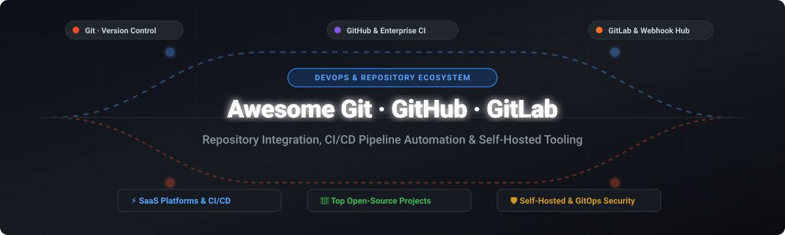

  

# 🚀 Awesome Git, GitHub & GitLab Repository Integration Ecosystem 🌐

**Curated List of SaaS Platforms & Open-Source Projects for Git Automation, CI/CD Hooks, Code Review & Repository Tooling**  
*Comprehensive developer guide for Version Control System (VCS) connectivity, developer productivity, GitOps, and self-hosted source control architectures.*  
*Last updated: 2026*

---

## 📑 Table of Contents
- [📌 Overview](#-overview)
- [📊 Sector Overview & Market Dynamics](#-sector-overview--market-dynamics)
- [☁️ SaaS & Hosted Platforms](#️-saas--hosted-platforms)
- [💻 Open-Source Projects](#-open-source-projects)
- [🤝 How to Contribute](#-how-to-contribute)
- [📈 Star History](#-star-history)
- [💖 Support & Sponsorship](#-support--sponsorship)
- [⚠️ Disclaimer](#️-disclaimer)

---

## 📌 Overview

This repository is an SEO-optimized, community-driven directory tracking the premier **SaaS platforms** and **open-source developer tools** powering the **Git, GitHub, and GitLab Repository Integration ecosystem**. Modern software engineering teams depend on reliable repository integrations to connect version control systems with automated continuous integration (CI/CD) pipelines, real-time code quality scanners, testing clouds, and project tracking tools.

Whether your team is configuring enterprise webhook triggers for **BrowserStack** test suites, architecting hybrid clouds with **GitHub Enterprise Connect**, automating deployments via **GitOps**, or hosting sovereign Git servers with **Gitea** and **Gerrit**, this guide provides structured breakdowns of pricing tiers, trial limits, valuations, and open-source popularity metrics.

---

## 📊 Sector Overview & Market Dynamics

The global **DevOps and Source Code Management (SCM) software market** is estimated at approximately **$12.5B – $14.2B in 2026**, growing at a robust compound annual growth rate (CAGR) of ~19.5% fueled by enterprise cloud migration, automated GitOps pipelines, and AI-accelerated development lifecycles.

The repository integration and version control sector exhibits a **highly concentrated market structure** among core source hosting and foundational cloud services—where Microsoft (GitHub & Azure DevOps), GitLab, Atlassian (Bitbucket), and Amazon Web Services command dominant market shares in a near winner-take-most dynamic. However, the ecosystem remains **moderately fragmented in peripheral tooling and integration layers** (specialized testing clouds like BrowserStack, desktop GUI clients like GitKraken, and code review engines like Gerrit), creating vibrant niches for self-hosted, privacy-first open-source alternatives.

---

## ☁️ SaaS & Hosted Platforms

*Below is a curated comparison of leading SaaS repository integration platforms, ordered by company size (valuation / annual revenue, descending).*

| Product | Company Size (Valuation / Revenue) | Description | Starting Pricing | Free Tier / Trial Limits |
|:---|:---|:---|:---|:---|
| **[Azure Repos](https://azure.microsoft.com/en-us/products/devops/repos/)** ☁️ | **~$3.1 Trillion** (Microsoft Market Cap / Parent) | Cloud-hosted private Git repositories within Azure DevOps featuring pull requests, branch policies, Git Credential Manager authentication, and tight integration with Azure Pipelines and IDEs. | $6.00/user/month (Basic Plan) | **Free Forever**: 5 users, unlimited private Git repositories, 1,800 free pipeline build minutes/month |
| **[AWS CodeCommit](https://aws.amazon.com/codecommit/)** 📦 | **~$2.1 Trillion** (Amazon Market Cap / Parent) | Fully managed, secure source control service hosting private Git repositories with AWS KMS encryption, CodeBuild/CodePipeline integrations, and CloudWatch event automations. | $1.00/active user/month (beyond the 5 free users) | **Free Forever**: First 5 active users/month, 50 GB storage/month, and 10,000 Git requests/month |
| **[GitHub Enterprise Connect](https://docs.github.com/en/enterprise-server/admin/configuring-settings/configuring-github-connect/about-github-connect)** 🐙 | **~$100+ Billion** (GitHub division of Microsoft, $2B+ ARR) | Secure hybrid bridge connecting GitHub Enterprise Server (GHES) on-premises to GitHub Enterprise Cloud (GHEC) for unified search, Dependabot alerts, and GitHub Actions access. | $21.00/user/month (GitHub Enterprise starting tier, billed annually) | **30-day Free Trial**: Full GitHub Enterprise Cloud/Server features with up to 50 user seats during trial |
| **[Bitbucket Cloud](https://bitbucket.org/)** 🪣 | **~$45+ Billion** (Atlassian Market Cap / Parent) | Enterprise Git code management with deep two-way Jira integration, built-in Bitbucket Pipelines for automated CI/CD, and Atlassian Marketplace developer extensions. | $3.00/user/month (Standard Plan) | **Free Forever**: Up to 5 users, 50 Bitbucket Pipelines build minutes/month, 1 GB Git LFS storage |
| **[GitLab CI/CD](https://docs.gitlab.com/ci/)** 🦊 | **~$8.5 Billion** (GitLab Public Market Cap, $700M+ ARR) | Complete integrated DevOps platform offering Git repository management, automated CI/CD pipelines via `.gitlab-ci.yml`, and external repository pull request mirroring. | $29.00/user/month (GitLab Premium) | **Free Forever**: 400 compute minutes/month, 5 GB storage, and unlimited self-hosted runners |
| **[BrowserStack Version Control Integration](https://www.browserstack.com/)** 📱 | **~$4.0 Billion** (Valuation, $200M+ ARR) | Cross-browser & real-device mobile testing cloud with bidirectional repository integrations (GitHub, GitLab, Bitbucket, Jenkins) enabling automated CI test triggers and debugging. | $29.00/user/month (Desktop Live starting plan, billed annually) | **Free Trial Only**: 14-day free trial with 100 minutes of automated testing and 30 minutes of interactive browser testing |
| **[GitKraken](https://www.gitkraken.com/)** 🐙 | **~$300 Million** (Estimated Valuation / Axosoft Spinoff) | Cross-platform Git GUI client, workspace manager, and CLI integration suite connecting with GitHub, GitLab, Bitbucket, Azure DevOps, Jira, and Trello. | $4.95/user/month (GitKraken Pro, billed annually) | **Free Forever**: Community Edition for public GitHub/GitLab repositories with view-only issue tracking |

---

## 💻 Open-Source Projects

*Below is a ranked list of standout open-source Git repository integration tools, self-hosted VCS platforms, and GitOps engines, sorted by GitHub stargazers count (descending).*

| Project | Stars | Description |
|:---|:---|:---|
| **[nektos/act](https://github.com/nektos/act)** ⚡ |  | Run your GitHub Actions locally via Docker containers for rapid pipeline testing and fast feedback loops without pushing commits. |
| **[Gitea](https://github.com/go-gitea/gitea)** ☕ |  | Ultra-lightweight, self-hosted Git server written in Go with full support for webhooks, package registries, pull requests, and CI/CD integrations. |
| **[Gogs](https://github.com/gogs/gogs)** 🌲 |  | Painless, self-hosted Git service written in Go designed for minimal resource consumption and effortless deployment on cross-platform architectures. |
| **[GitHub CLI (cli/cli)](https://github.com/cli/cli)** 💻 |  | The official command-line interface for GitHub that brings pull requests, issues, Actions, releases, and repository configuration into the terminal. |
| **[Argo CD](https://github.com/argoproj/argo-cd)** 🐙 |  | Declarative, GitOps continuous delivery tool for Kubernetes that connects Git repositories directly to cluster state for automated deployment syncing. |
| **[GitLab Community Edition (Mirror)](https://github.com/gitlabhq/gitlabhq)** 🦊 |  | Open-source core codebase of GitLab providing self-managed repository hosting, code review workflows, issue tracking, and CI/CD pipelines. |
| **[Renovate](https://github.com/renovatebot/renovate)** 🤖 |  | Universal multi-platform automated dependency update bot supporting GitHub, GitLab, Bitbucket, and Gitea with customizable auto-merge policies. |
| **[GitHub Desktop](https://github.com/desktop/desktop)** 🖥️ |  | Simple and intuitive open-source Git graphical interface built with Electron and TypeScript for frictionless branch management and commit workflows. |
| **[Git Credential Manager](https://github.com/git-ecosystem/git-credential-manager)** 🔑 |  | Secure cross-platform Git credential helper providing multi-factor authentication (MFA) and OAuth token management for GitHub, Azure Repos, and GitLab. |
| **[Atlantis](https://github.com/runatlantis/atlantis)** 🏛️ |  | Terraform pull request automation tool that runs `terraform plan` and `terraform apply` directly via PR comments on GitHub, GitLab, and Bitbucket. |
| **[Flux CD](https://github.com/fluxcd/flux2)** 🔄 |  | CNCF-graduated open-source GitOps toolkit for keeping Kubernetes clusters in sync with configuration held across Git repositories. |
| **[Gerrit Code Review](https://github.com/GerritCodeReview/gerrit)** 🔍 |  | Web-based team code collaboration and review platform for Git with fine-grained ACLs, change approval matrices, and SSH stream event triggers. |
| **[RhodeCode](https://github.com/rhodecode/rhodecode-enterprise-ce)** 🛡️ |  | Unified repository management engine supporting Git, Mercurial, and Subversion with webhook integrations, Jenkins triggers, and LDAP authentication. |

---

## 🤝 How to Contribute

Contributions are warmly welcomed! Help expand this ecosystem map by adding tools, updating pricing details, or refining integration documentation:

1. 🍴 **Fork the repository** on GitHub.
2. 🌿 **Create a new branch** (`git checkout -b feature/add-new-tool`).
3. ✏️ **Edit `README.md`**: Follow the established table schema (ensure pricing, free tier limits, and valuation or star counts are documented accurately).
4. 💾 **Commit your changes** (`git commit -m 'Add ToolName to Git repository integrations'`).
5. 🚀 **Push to your branch** (`git push origin feature/add-new-tool`).
6. 📬 **Submit a Pull Request** with a clear explanation of the integration value proposition.

---

## 📈 Star History

---

## 💖 Support & Sponsorship

If you find this repository valuable for your DevOps workflows, architectural research, or open-source discovery, please consider supporting the project:

- ⭐ **Star this repository** to help other engineers discover it.
- 🍴 **Fork and share** with your developer community and platform teams.
- ☕ **Buy a coffee & sponsor**: Support ongoing open-source curation and tool tracking directly on the [**GitHub Sponsors Dashboard**](https://github.com/sponsors/ishandutta2007).

Thank you for being part of the open-source and developer tools community! 🌟

---

## ⚠️ Disclaimer

- This compilation is a **community-curated developer reference** — inclusion does not represent an endorsement or commercial partnership.
- Repository integrations frequently require repository read/write access, deployment secrets, and webhook tokens; always enforce least-privilege principles, rotated access tokens, and comprehensive audit logs.
- All trademarks, service marks, and trade names are the property of their respective owners. Product pricing, trial specifications, and market caps are subject to periodic change by their vendors.
